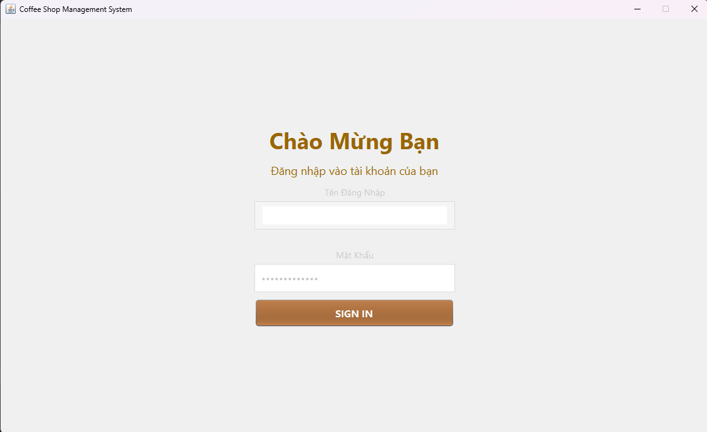
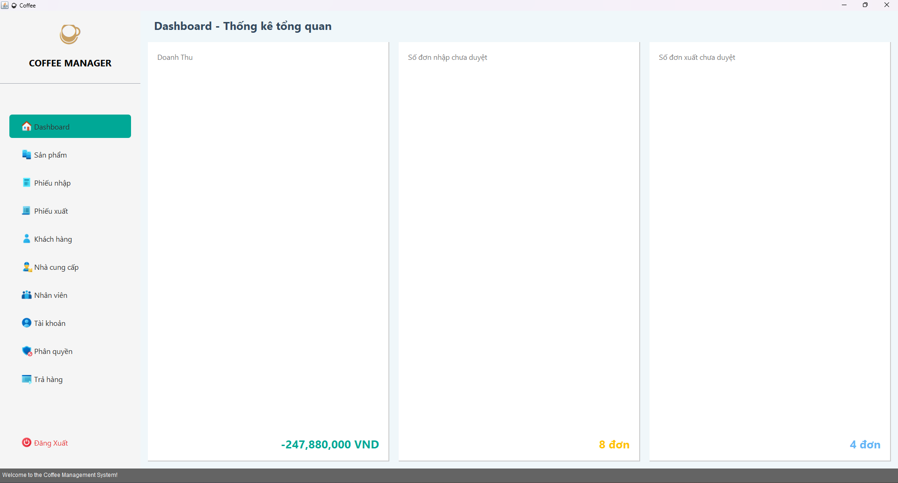
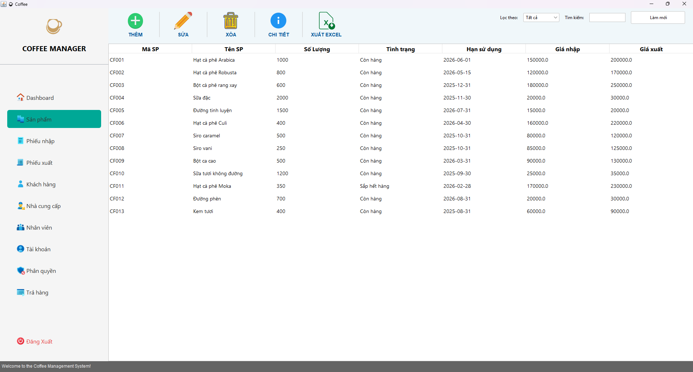
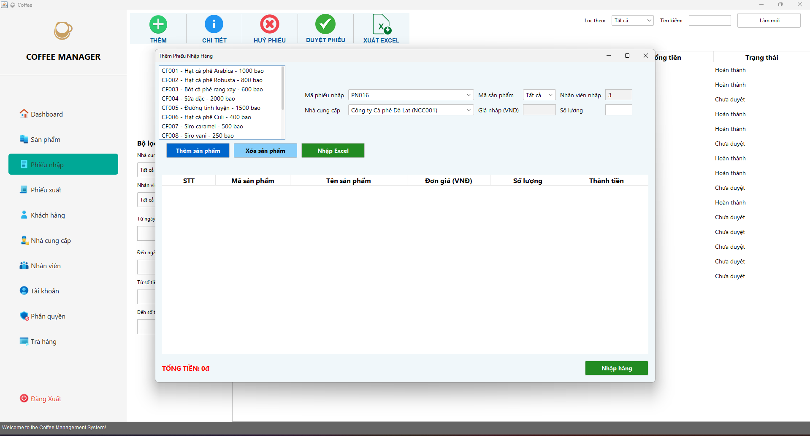
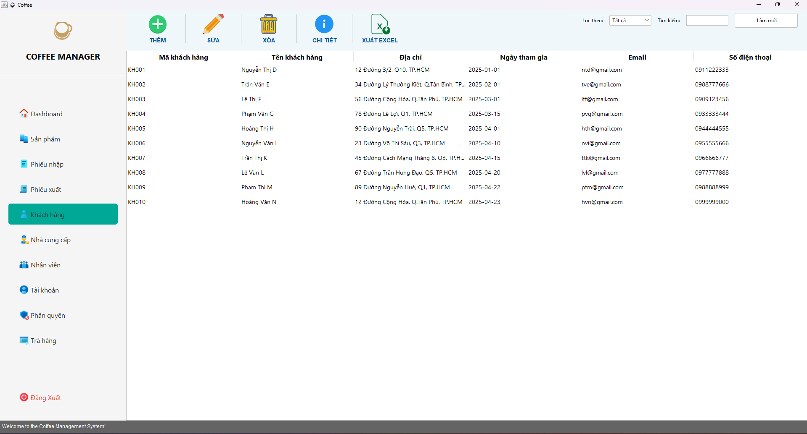

# Quản lý kho hàng cà phê

Ứng dụng desktop hỗ trợ quản lý hoạt động nhập, xuất và theo dõi hàng hóa cho cửa hàng cà phê. Dự án được phát triển bằng Java Swing, tổ chức mã nguồn theo các lớp DTO, Repository và DAO, sử dụng JDBC để làm việc với MySQL.

## Chức năng chính

- Đăng nhập và phân quyền thao tác theo tài khoản.
- Quản lý sản phẩm, nhà cung cấp, nhân viên và khách hàng.
- Lập và theo dõi phiếu nhập, phiếu xuất, chi tiết phiếu và trả hàng.
- Tìm kiếm, lọc và kiểm tra dữ liệu trước khi lưu.
- Xuất dữ liệu nghiệp vụ sang Excel và PDF.

## Công nghệ sử dụng

- Java 17 và Java Swing
- JDBC và MySQL
- Mô hình DTO, Repository và DAO
- FlatLaf và JCalendar
- Apache POI cho xuất Excel
- iText cho xử lý tài liệu PDF
- Apache Ant và NetBeans

## Cấu trúc mã nguồn

```text
src/
├── Config/       Cấu hình kết nối và phiên đăng nhập
├── DTO/          Đối tượng truyền dữ liệu
├── Repository/   Hợp đồng truy cập dữ liệu
├── Dao/          Cài đặt truy vấn JDBC
├── View/         Giao diện và luồng thao tác Swing
├── EX/           Xuất dữ liệu Excel
└── PDF/          Xuất dữ liệu PDF
```

## Cài đặt và chạy dự án

### Yêu cầu

- JDK 17 trở lên
- MySQL 8 hoặc XAMPP có MySQL
- NetBeans IDE

### Khởi tạo cơ sở dữ liệu

1. Tạo database có tên `quanlycuahang2`.
2. Import tệp `database/db.sql`.
3. Cấu hình kết nối bằng các biến môi trường:

```powershell
$env:DB_URL="jdbc:mysql://localhost:3306/quanlycuahang2?useUnicode=true&characterEncoding=UTF-8"
$env:DB_USER="root"
$env:DB_PASSWORD="mat_khau_mysql_cua_ban"
```

Nếu không khai báo, ứng dụng sử dụng địa chỉ local, tài khoản `root` và mật khẩu trống để phù hợp với cấu hình XAMPP mặc định.

### Chạy ứng dụng

1. Clone repository và mở thư mục dự án bằng NetBeans.
2. Kiểm tra các thư viện trong `src/lib` đã được thêm vào classpath.
3. Chạy lớp `View.LoginMain`.

Dữ liệu mẫu trong file SQL có tài khoản quản trị `3` và mật khẩu `3`. Tài khoản này chỉ dành cho môi trường chạy thử trên máy cá nhân.

## Giao diện

### Đăng nhập



### Trang tổng quan



### Quản lý sản phẩm



### Lập phiếu nhập



### Quản lý khách hàng


